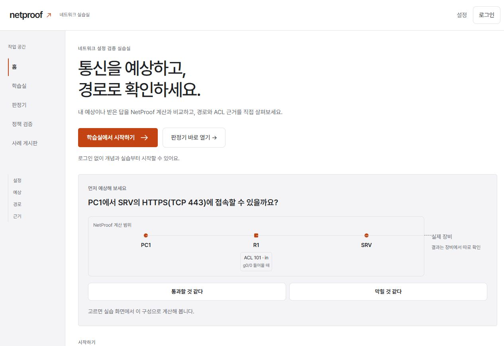
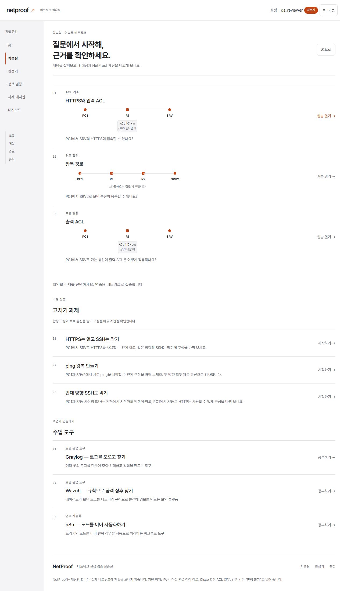
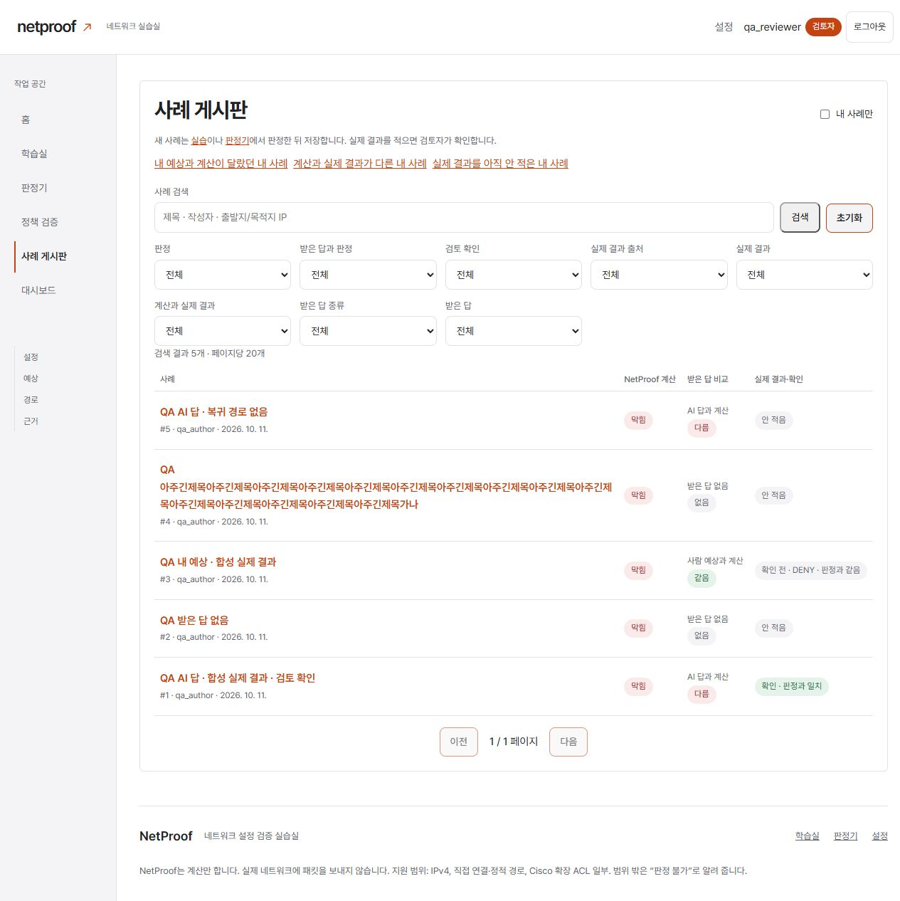
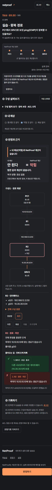

# NetProof — Verify before you trust.

네트워크 구성에 대한 AI의 답이나 내 예상을 계산으로 확인하고, 경로·규칙의 근거와 실제 실습 결과를 비교하며 배우는 웹앱.
SKT ALEPH 프리미엄 실습 프로젝트. 계획은 [`plan.md`](plan.md), 판정 규칙은 [`docs/semantics.md`](docs/semantics.md).

[공개 NetProof](https://netproof-vert.vercel.app/)에서 로그인 없이 학습·실습·판정·정책 검증을 시작할 수 있습니다.

**예상 → 계산 → 경로와 규칙 확인 → 구성 수정 → 다시 계산 → 사례 기록·실제 결과 비교**

## 현재 화면과 기능

PR #60이 병합된 main `cc9d8a5` 기준입니다(2026-10-11). 중성 회색·오렌지의 경로 작업대와 왼쪽 탐색을 적용했습니다. 아래 캡처는 같은 제품 버전을 임시 SQLite에서 확인한 화면입니다. 공개 홈·학습실에도 반영된 것을 확인했습니다.



| 학습실 | 사례 게시판 |
|---|---|
|  |  |



> 화면의 닉네임과 사례는 설명용 예시입니다(합성 사례, 실제 실습 결과가 아님). 동기들의 실제 사례는 사용자 테스트에서 모읍니다.

| 기능 | 할 수 있는 일 |
|---|---|
| 학습실·실습 | 개념·연습용 구성을 살펴보고 내 예상과 계산을 비교, 구성 편집·다시 판정·사례 기록 |
| 고치기 과제 | 목표 통신과 처음 구성을 받고 목표별 계산·목표 밖 변화를 확인. 정답·점수·완료 표시는 없음 |
| 판정기·구성도 | IPv4 통신의 판정·경로·규칙 근거, 구성도와 정방향·복귀 단계 재생, pfSense 방식 상태 추적 방화벽의 들어오는 규칙 입력 |
| 정책 검증 | 여러 호스트·서비스의 도달성 표와 의도한 정책 비교, 변경 전/후 다른 통신 영향 |
| ACL 점검·수정 후보 | 규칙의 중복·가려짐·열린 범위 확인, 엔진이 계산한 제한된 수정 후보 확인 |
| 사례·검토자 대시보드 | 받은 답·계산·사람이 적은 실제 결과를 구분, 확인 표시·오탐/미탐·원인 통계 |
| 개발용 검증 도구 | 기준 사례·불일치 회귀 내보내기, 엔진 버전별 재판정, 로컬 Batfish 교차 검증 |

현재 화면의 설계·검증 근거는 [`docs/path-workbench.md`](docs/path-workbench.md), 사람의 확인 대기는 [`docs/qa-manual.md`](docs/qa-manual.md), 다음 작업은 [`HANDOFF.md`](HANDOFF.md)에 있습니다. 2026-10-06 기준의 소개·회고는 [`docs/netproof-retrospective-2026-10-06.md`](docs/netproof-retrospective-2026-10-06.md)에 날짜별 기록으로 남깁니다.

## 구조

| 폴더 | 내용 |
|---|---|
| `engine/` | 판정 엔진(Python, 표준 라이브러리만). 최종 PASS/DENY는 여기서만 정한다 |
| `server/` | Flask 서버. 로그인(Argon2id·서버 세션·CSRF·잠금), 사례 게시판, 검토자 등급, 대시보드, 크기 제한, 보안 헤더. 빌드된 화면도 함께 내보낸다 |
| `api/` | Vercel 서버리스 진입점 `index.py` 하나(서버를 불러 온다) |
| `web/` | React + TypeScript 화면: 홈·학습실·실습·고치기·판정기·정책 검증·사례·대시보드·계정 |
| `cases/` | 사람이 기대값을 정한 기준 사례. 현재 합성 사례 3개이며 실제 장비 결과가 있는 기준 사례는 아직 없다 |
| `scripts/` | 임시 SQLite QA 준비·로컬 Batfish 교차 검증. 운영 의존성과 별도로 사용 |
| `decisions/` | AI 작업 기록, 불일치 로그 |
| `HANDOFF.md` 외 | Claude(설계·리뷰) ↔ Codex(구현) 협업의 현재 상태와 규칙. `CLAUDE.md`·`AGENTS.md`·`PROMPTS.md` |

## 권한

| | 비로그인 | 일반(동기) | 검토자 |
|---|---|---|---|
| 홈·학습실·실습·고치기·판정기·정책 검증 | ○ | ○ | ○ |
| 사례 게시판 보기 | × (401) | ○ | ○ |
| 사례 저장, 자기 사례의 실제 결과 적기·수정·삭제 | × | ○ | ○ |
| 실제 결과 확인 표시, 대시보드, 기준 사례 내보내기, 아무 사례 삭제 | × | × (403) | ○ |

검토자 등급은 웹에서 올릴 수 없다. 서버에서만: `.venv/Scripts/python -m flask --app server/wsgi.py make-reviewer <닉네임>` (되돌리기: `make-user`).
확인된 사례의 실제 결과나 구성이 바뀌면 확인은 자동으로 풀린다. 저장되는 판정은 언제나 서버가 다시 계산한 값이다.

## 실행 (Windows)

```bash
python -m venv .venv
.venv/Scripts/python -m pip install -e "engine[test]" -r requirements.txt
npm --prefix web install
npm --prefix web run build
.venv/Scripts/python -m flask --app server/wsgi.py run --port 4820
```

http://127.0.0.1:4820 에서 연다. DB는 기본으로 `instance/netproof.db`(SQLite)이고, `DATABASE_URL`로 PostgreSQL을 쓸 수 있다.
배포는 Vercel + Supabase — 순서와 누가 무엇을 하는지는 [`docs/deploy.md`](docs/deploy.md). 화면을 고치는 중이면 `npm --prefix web run dev`(5820, API는 4820으로 넘김).

## 검사

```bash
cd engine && ../.venv/Scripts/python -m pytest -q   # 엔진: 단위·속성·사례 파일
cd server && ../.venv/Scripts/python -m pytest -q   # 서버: 로그인·권한·게시판·대시보드·배포 설정
npm --prefix web test                               # 화면: 입력 변환·주소
npm --prefix web run build                          # TypeScript 검사·운영 번들
```

사례 하나를 명령줄에서 판정: `PYTHONPATH=engine/src .venv/Scripts/python -m netproof_engine cases/synthetic-01-https-acl.json`

## 하지 않는 것

실제 네트워크에 패킷을 보내지 않는다(ADR-011). 최종 PASS/DENY는 엔진만 정하며, 받은 답·내 예상은 비교에만 쓰인다. 실제 결과와 사례 기대값은 사람이 확인한다.

엔진 0.2.0은 IPv4·직접 연결·정적 경로·Cisco 확장 ACL 일부와 제한된 구조화 상태 추적을 지원한다. 상태 추적의 조건과 미지원 범위는 [`docs/semantics.md` §14](docs/semantics.md#14-제한된-상태-추적-방화벽-adr-016)에 있다. 판정기 구성에서 장비 종류를 "방화벽"으로 고르면 인터페이스별 들어오는 규칙과 기본 동작을 화면에서 적는다. 실제 pfSense 장비 대조는 후속이다. IPv6·NAT·동적 라우팅·VLAN·모델 밖 방화벽 기능이 판정에 필요하면 "판정 불가(UNSUPPORTED)"로 멈춘다.

기준 사례·Batfish 교차 검증의 일치는 실제 장비 동작을 보증하지 않는다. 운영 재판정은 비밀번호 미확보로 보류 중이며, Vercel DATABASE_URL을 Production에만 적용하도록 바꾸는 일은 사용자에게 남아 있다.

## 라이선스

[MIT](LICENSE)

문서 정리: Codex (GPT-6)
