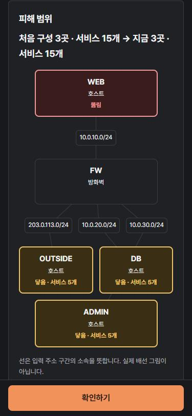
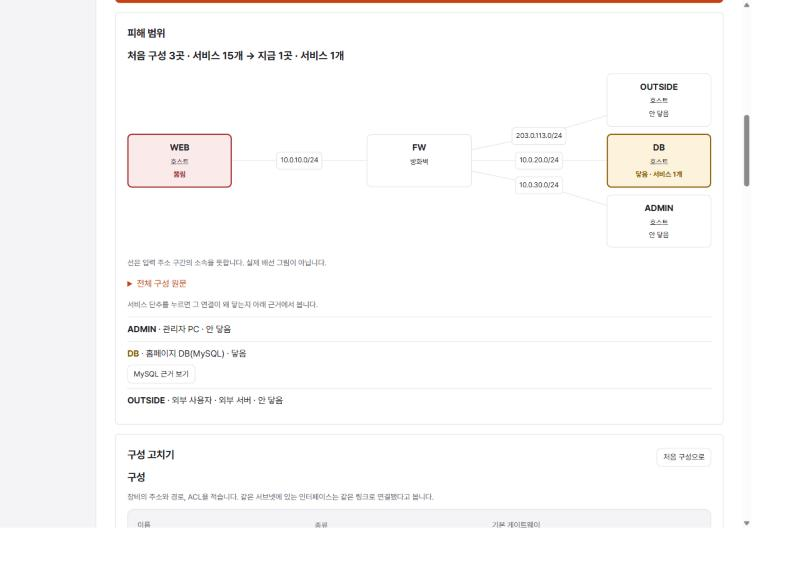
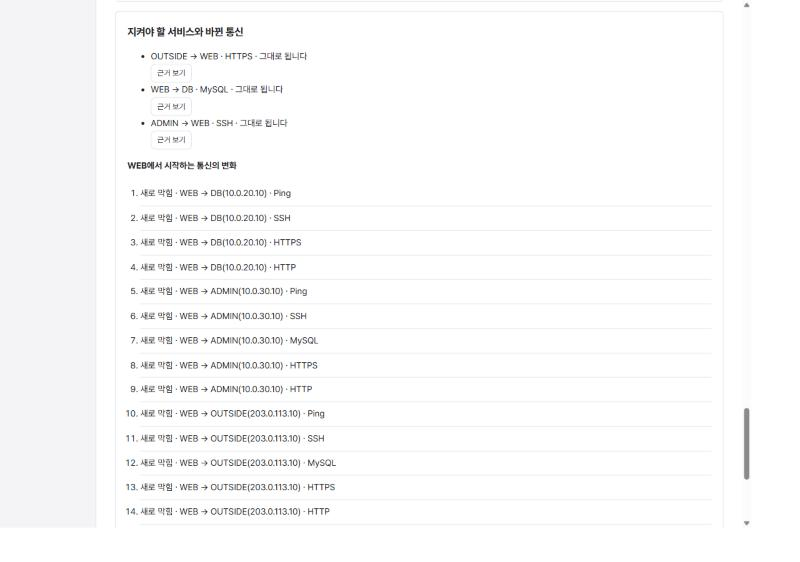
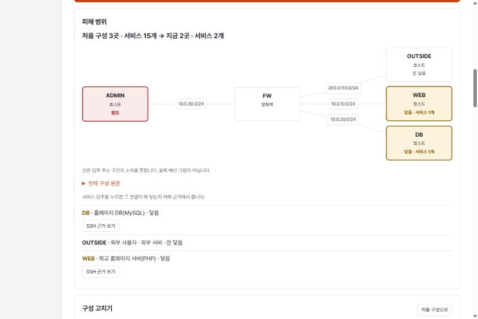
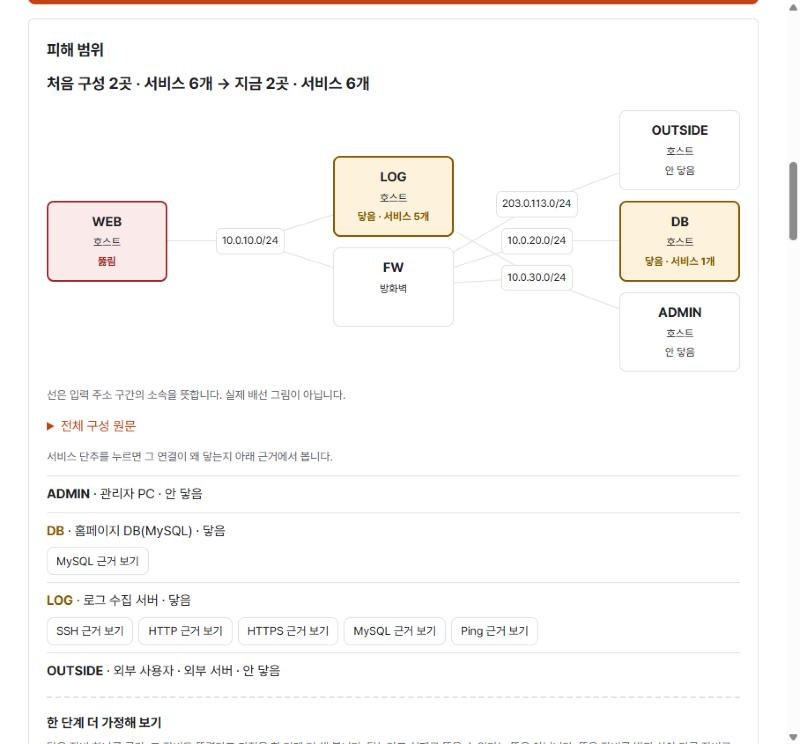
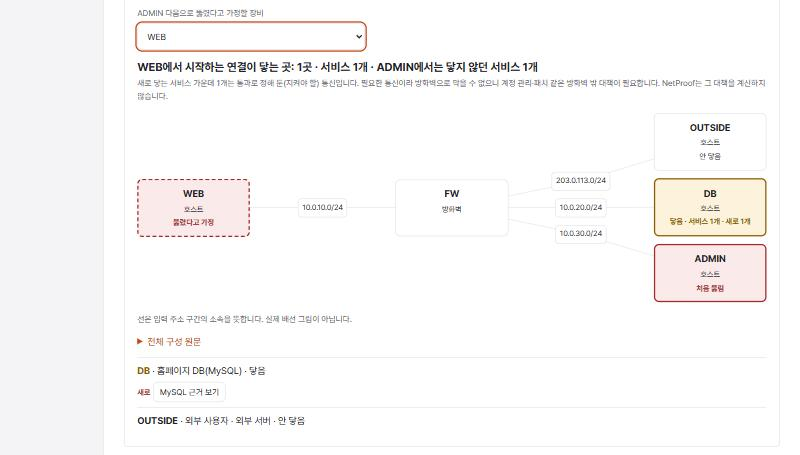
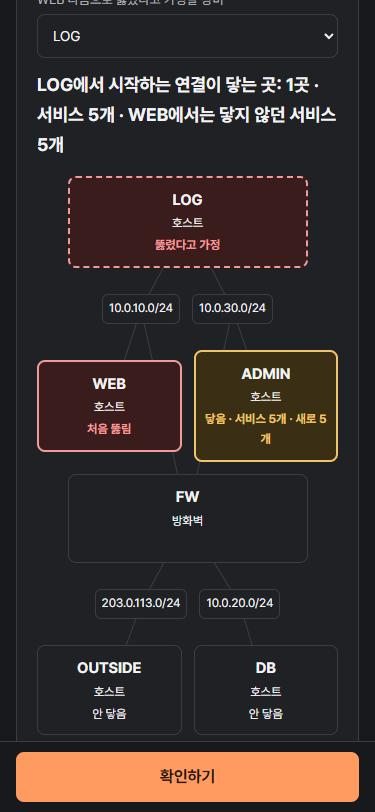

# 침해 가정 실습 설계 — "뚫린 서버에서 어디까지 닿나"

2026-10-24 · 설계: Claude (Opus 5.5), 사용자 위임("너가 판단해줘") · 상태: **사용자 승인(2026-10-24) 뒤 구현함**(같은 브랜치 `claude/breach-practice`, PR #66) · 기준 브랜치 `claude/firewall-input`(PR #65) 위

구현 결과와 시험·실브라우저 기록은 HANDOFF의 "테스트 결과 — 침해 가정 실습"에 있다. 구현에서 이 문서와 달라진 점은 두 가지다.
- `reach()`는 계산 편의를 위해 `others`(뚫린 장비 외 장비)와 `unknown`(판정 불가 칸만 있는 장비)을 함께 돌려준다.
- 웹 시험은 엔진 0.2.0 응답을 저장한 `web/src/testFixtures/breach-responses.json`으로 확인한다.

| 휴대폰 다크 · 피해 범위 지도 | 데스크톱 라이트 · 규칙을 고친 뒤 |
|---|---|
|  |  |



## 1. 왜 만드는가

- **학생이 가져갈 한마디(Claude 판단):** "서버 하나가 뚫려도 피해가 그 구역에 머물게, 필요한 길만 남긴다."
- **누구를 위한 것인가:** 보안 네트워크를 배우는 입문 학생이다. 사용자가 정한 방향은 "학생에게 교육적으로 도움이 되고, 처음 와도 헤매지 않는 사이트"다.
- **NetProof다운 점:** 지금까지 NetProof는 "이 통신이 되나?" 하나를 물었다. 침해 가정 실습은 질문을 공격자 쪽으로 뒤집는다. **"이미 뚫린 장비에서 어디까지 닿나?"** 답은 지금처럼 엔진이 계산하고, 학생은 먼저 예상해 본 뒤 계산과 비교한다. 이 순서는 기존 흐름(예상 → 계산 → 근거 → 고치기)을 그대로 따른다.
- **착안점:** 웹 서버 침해 사고가 반복해서 보도된다. 특정 기사를 인용하지는 않는다. 장면은 흔한 유형(웹 게시판에 올라온 웹셸)으로 일반화한다.
- **수업·팀 과제와의 연결:** 팀 캡스톤의 S7(홈페이지 변조)·S8/S10(스캔→침입)과 망 허용표의 원칙을 학생 수준으로 옮긴다. 옮기는 원칙은 두 가지다. 구역마다 밖으로 나가는 새 연결은 기본적으로 막고, 관리 경로는 따로 둔다.
- **바로 앞 기능을 쓴다:** PR #65의 방화벽 화면 입력을 그대로 쓴다. 이 실습의 핵심 깨달음이 상태 추적 방화벽에서 나온다(§3.3).

## 2. 학생이 겪는 흐름 (5단계)

| 단계 | 학생이 하는 일 | 화면 |
| --- | --- | --- |
| ① 상황 | 이야기를 읽는다: "학교 홈페이지 서버(WEB)의 PHP 게시판에 웹셸이 올라왔다고 가정합니다. 공격자는 이제 WEB 안에서 명령을 실행할 수 있습니다." | 상황 글, 장비 역할 표, 지켜야 할 서비스 3개 |
| ② 예상 | 다른 장비마다 "닿을 것 같다 / 안 닿을 것 같다"를 고른다(선택). | 장비별 두 갈래 선택. 고르지 않아도 다음으로 갈 수 있다 |
| ③ 계산 | "확인하기"를 누른다. | **피해 범위 지도**: 구성도에서 WEB은 "뚫림", 다른 장비는 "닿음 · 서비스 n개" 또는 "안 닿음"으로 보인다. 아래에는 장비별로 닿는 서비스 목록이 있고, 처음 구성에 대한 내 예상과 계산이 같은지 다른지 보인다 |
| ④ 막기 | 방화벽 규칙을 고친다. | 기존 구성 편집기. 방화벽 규칙 목록은 PR #65에서 만든 것이다 |
| ⑤ 다시 확인 | "확인하기"를 다시 누른다. | 처음 구성과 지금 구성의 피해 범위(장비 n곳·서비스 m개), 공격자에서 시작하는 통신 중 새로 막힌 것과 새로 열린 것, 그 밖의 변화, 지켜야 할 서비스 3개의 상태 |

닿는 서비스마다 **"왜 닿나요?"** 단추가 있다. 누르면 판정기와 같은 근거 패널이 열린다. 구성도, 경로 재생, 그리고 `FW em1 1번 규칙 · 통과 · 모든 프로토콜 · any → any` 같은 규칙 한 줄이 보인다. 학생은 이 패널에서 어느 규칙이 길을 열었는지 직접 찾는다.

## 3. 실습망 `breach-01` "학교 홈페이지가 뚫렸다면"

### 3.1 장비와 구역

주소는 문서·시험용 대역(203.0.113.0/24)과 사설 대역만 쓴다. 장비 이름은 ASCII로 두고, 화면에는 역할 이름을 함께 보인다.

| 장비 | 역할(화면 표시) | 구역 | 주소 / 게이트웨이 |
| --- | --- | --- | --- |
| `OUTSIDE` | 외부 사용자 · 외부 서버 | 외부 | 203.0.113.10/24 → 203.0.113.1 |
| `WEB` | 학교 홈페이지 서버(PHP) · **뚫림** | DMZ | 10.0.10.10/24 → 10.0.10.1 |
| `DB` | 홈페이지 DB(MySQL) | DB | 10.0.20.10/24 → 10.0.20.1 |
| `ADMIN` | 관리자 PC | 관리 | 10.0.30.10/24 → 10.0.30.1 |
| `FW` | 방화벽(상태 추적) | — | em0 203.0.113.1/24 · em1 10.0.10.1/24 · em2 10.0.20.1/24 · em3 10.0.30.1/24 |

### 3.2 처음 구성: "편하게 열어 둔 방화벽"

| 인터페이스(들어오는 쪽) | 규칙 | 어느 규칙에도 안 맞으면 |
| --- | --- | --- |
| em0 (외부) | 1. 통과 · TCP · any → 10.0.10.10:443 | 차단 |
| em1 (DMZ, WEB이 시작하는 연결) | 1. 통과 · 모든 프로토콜 · any → any | 차단 |
| em2 (DB) | 없음 | 차단 |
| em3 (관리) | 1. 통과 · 모든 프로토콜 · 10.0.30.0/24 → any | 차단 |

"DMZ에서 나가는 연결은 일단 다 열어 둔다"는 흔한 실수를 그대로 재현한다.

### 3.3 지켜야 할 서비스(요구사항, 정답 아님)

| 통신 | 이유 |
| --- | --- |
| `OUTSIDE → WEB` HTTPS(443) | 누구나 홈페이지에 접속한다 |
| `WEB → DB` MySQL(3306) | 홈페이지가 DB를 쓴다 |
| `ADMIN → WEB` SSH(22) | 관리자가 웹서버를 관리한다 |

검사하는 서비스는 SSH·HTTP·HTTPS·MySQL·Ping이고, 왕복(session)으로 계산한다.

엔진 0.2.0으로 직접 계산해 확인했다(2026-10-24, 저장소 밖 임시 스크립트).

| 구성 | WEB에서 닿는 곳 | 지켜야 할 서비스 3개 |
| --- | --- | --- |
| 처음 구성 | 3곳(OUTSIDE·DB·ADMIN) × 5서비스 = 15 | 모두 통과 |
| em1을 `통과 · TCP · 10.0.10.10 → 10.0.20.10:3306` 하나로 줄인 구성(참고, 제품에 넣지 않음) | DB MySQL 1 | 모두 통과 |
| em1 규칙을 모두 지운 구성 | 0 | `WEB → DB` MySQL만 막힘 |

**핵심 깨달음:** em1을 좁혀도 홈페이지 응답과 관리자 SSH는 끊기지 않는다. 상태 추적 방화벽이 바깥에서 시작한 연결의 응답을 상태로 돌려보내기 때문이다. 반대로 em1을 전부 막으면 서비스가 깨진다. 학생은 "필요한 길만 남긴다"를 숫자(15 → 1)와 깨진 서비스로 함께 겪는다.

과제 문구에는 고칠 장비·규칙·원인을 쓰지 않는다(고치기 과제의 기존 합의와 같다). 참고 구성은 서버 시험 파일에만 둔다.

### 3.4 두 번째 장면 `breach-02` "관리자 PC가 뚫렸다면" (2026-10-24 추가)

첫 장면에서 DMZ(em1)를 `통과 · TCP · 10.0.10.10 → 10.0.20.10:3306` 하나로 좁힌 같은 학교 망에서 이어진다. 이번에는 관리자 PC(ADMIN)에서 피싱 메일의 첨부 파일이 실행됐다고 가정한다. 배울 점은 "관리 구역도 필요한 관리 포트만 남긴다"다.

- **지켜야 할 서비스:** OUTSIDE→WEB HTTPS, WEB→DB MySQL, ADMIN→WEB SSH, ADMIN→DB SSH.
- **처음 구성의 em3:** `통과 · 모든 프로토콜 · 10.0.30.0/24 → any`.
- **엔진 0.2.0 계산**(서버 시험 `test_breach_02_*`로 고정):

| 구성 | ADMIN에서 닿는 곳 | 지켜야 할 서비스 4개 |
| --- | --- | --- |
| 처음 구성 | 3곳 × 5서비스 = 15 | 모두 통과 |
| em3을 관리 SSH 두 개(WEB·DB 22)로 줄인 구성(참고, 제품에 넣지 않음) | WEB SSH·DB SSH 2 | 모두 통과 |
| em3 규칙을 모두 지운 구성 | 0 | ADMIN→WEB SSH·ADMIN→DB SSH 막힘 |

화면 코드는 바꾸지 않았다. `breach.json`에 장면을 더하면 학습실 카드·주소·화면이 그대로 동작한다.



### 3.5 세 번째 장면 `breach-03` "방화벽을 거치지 않는 길" (2026-10-24 추가)

**왜:** 같은 반 팀 프로젝트 기획안 다섯 개를 읽어 보니 모두 pfSense를 쓰고, 그중 네 곳이 "방화벽을 거치지 않는 길"을 위험으로 적었다. 같은 VLAN 안 통신, 가상 어댑터 때문에 호스트가 랩 구역에 들어가는 경우, 서버 주소로 바로 접속하는 경우, 컨테이너 포트 직접 접근이 그 예다. 규칙을 아무리 좁혀도 **같은 구간 안의 통신은 방화벽을 지나지 않는다**는 점을 침해 가정으로 겪게 한다(이름·주소는 모두 합성).

- **이어지는 망:** 두 번째 장면에서 em3까지 관리 SSH 두 개로 좁힌 같은 학교 망이다. 여기에 로그 수집 서버(LOG)가 더해진다. LOG는 관리 구역 `10.0.30.20`에 있고, 설치 때 홈페이지 구역에 꽂은 두 번째 랜카드 `eth1 10.0.10.20`이 그대로 남아 있다. 뚫린 장비는 다시 WEB이다.
- **지켜야 할 서비스:** 두 번째 장면과 같은 4개.
- **배울 점:** WEB에서 LOG(`10.0.10.20`)로 가는 연결은 같은 구간이라 방화벽을 지나지 않는다. 방화벽 규칙을 모두 지워도 이 길은 남는다. 고치는 방법은 남은 랜카드를 빼는 것이다(구성 고치기에서 LOG의 eth1 삭제). 근거 패널에서 이 연결의 길에 방화벽 단계가 없다는 것을 직접 본다.
- **한 단계 더 가정(§4.1)과 이어짐:** LOG도 뚫렸다고 가정하면 같은 관리 구역의 ADMIN에 서비스 5개가 새로 닿는다. LOG의 홈페이지 구역 주소(`10.0.10.20`)에서 ADMIN으로 가는 칸 5개는 **판정 불가**다. 가는 길은 방화벽을 지나지 않고, ADMIN의 응답만 방화벽을 지나서 상태 정보가 없기 때문이다(비대칭 경로). 판정 불가 칸은 펼쳐서 주소·서비스와 근거 단추로 이유를 본다(2026-10-24, `reachTargets` 공용).
- **처음에 검토하고 버린 안:** 관리자 PC에 두 번째 랜카드를 붙이는 안은 비대칭 경로 때문에 지켜야 할 서비스(ADMIN→WEB SSH)가 처음부터 판정 불가가 되어 버렸다.
- **엔진 0.2.0 계산**(서버 시험 `test_breach_03_*`로 고정):

| 구성 | WEB에서 닿는 곳 | 지켜야 할 서비스 4개 |
| --- | --- | --- |
| 처음 구성 | LOG 5(방화벽을 지나지 않음) + DB MySQL 1 = 2곳 · 6 | 모두 통과 |
| 방화벽 규칙을 모두 지운 구성 | LOG 5만 남음 | 모두 막힘 |
| LOG의 eth1을 뺀 구성(참고, 제품에 넣지 않음) | DB MySQL 1 | 모두 통과 |



## 4. 화면

- **들어가는 곳:**
  - 주소 `#/breach/breach-01`.
  - 학습실에 "침해 가정 실습" 구역을 새로 두고 카드 한 장을 놓는다(고치기 과제 구역 위).
  - 페이지 위쪽에는 고치기 과제와 같은 위치 표시("학습실 › 침해 가정 실습")를 둔다.
- **보이는 순서(넓은 화면):** ① 상황·역할 표 → ② 예상 → 확인하기 → ③ 피해 범위(구성도 + 목록) → ④ 구성 편집(고치기 과제처럼 휴대폰에서는 접힘) → ⑤ 전/후·지켜야 할 서비스·변화 목록 → 근거 패널 → "판정기로 가져가기".
- **구성도:** 기존 `NetworkDiagram`에 선택 속성 `marks`(장비 id → 표시 종류와 글)를 더한다.
  - 경로 재생(trace)이 없을 때만 칸에 "뚫림 / 닿음 · 서비스 n개 / 안 닿음"을 보인다.
  - 색은 기존 의미 색을 그대로 쓴다. 뚫림은 차단과 같은 위험색, 닿음은 점검과 같은 경고색, 안 닿음은 중립이다.
  - 배치는 뚫린 장비가 맨 위층에 오게, 그 장비 주소에서 시작하는 흐름을 넘긴다(`topologyView`가 흐름의 출발 장비를 첫 층에 둔다). 이 흐름은 그림 배치에만 쓴다.
- **글로 된 목록이 기준이다:** 구성도는 보조 그림이다. 화면 읽기 프로그램은 장비별 목록을 읽는다(기존 Strip·목록과 같은 원칙).
- **말투(사용자 친화):**
  - "닿음"은 "방화벽과 경로가 막지 않아 연결을 시작할 수 있음"이라는 뜻이다. 화면 위쪽에 한 번 적는다: "서비스가 실제로 열려 있는지, 취약한지는 계산하지 않습니다."
  - "침투 가능", "털림" 같은 말은 쓰지 않는다.
  - 판정 불가는 "안 닿음"에 넣지 않고 따로 센다: "판정 불가 n건 — 안전하다는 뜻이 아닙니다".
- **휴대폰:** 구성도 → 목록 → 편집(접힘) 순서로 한 줄에 쌓는다. 예상 선택지는 장비 한 줄에 두 단추로 둔다.

### 4.1 한 단계 더 가정해 보기 — 2차 확산 (2026-10-24 추가, Claude 결정)

피해 범위 목록 아래에 둔다. 학생이 **처음 뚫린 장비에서 닿은 장비 하나를 직접 골라** 그 장비도 뚫렸다고 가정하면, 그 장비에서 시작하는 연결이 어디까지 닿는지 본다. 배울 점은 "뚫린 장비 하나가 다음 장비의 발판이 된다(측면 이동)"와 "꼭 필요한 통신 경로는 방화벽만으로 줄일 수 없다"다.

- **표현(닿음을 침투로 과장하지 않기):**
  - 제목 "한 단계 더 가정해 보기". 바로 아래에 한 번 적는다: "닿은 장비 하나를 골라, 그 장비도 뚫렸다고 가정을 한 단계 더 해 봅니다. 닿는다고 실제로 뚫을 수 있다는 뜻은 아닙니다. 뚫은 장비를 발판 삼아 다른 장비로 옮겨 가는 것을 측면 이동(lateral movement)이라고 합니다."
  - 고르는 칸 "{처음 장비} 다음으로 뚫렸다고 가정할 장비". 후보는 1차에서 **닿음**인 장비뿐이다. 처음에는 "고르지 않음"이다. 화면이 대신 고르지 않는다.
  - 결과 줄 "{고른 장비}에서 시작하는 연결이 닿는 곳: n곳 · 서비스 m개 · {처음 장비}에서는 닿지 않던 서비스 k개".
  - k=0이면 "{처음 장비}에서 이미 닿는 서비스뿐입니다. 이 가정으로 닿는 범위가 넓어지지 않습니다.", m=0이면 "{고른 장비}에서 시작하는 연결은 닿는 곳이 없습니다."
  - 새로 닿는 서비스 가운데 의도가 통과(`expect: PASS`, 이 실습에서는 지켜야 할 서비스)인 것이 있으면: "필요한 통신이라 방화벽으로 막을 수 없으니 계정 관리·패치 같은 방화벽 밖 대책이 필요합니다. NetProof는 그 대책을 계산하지 않습니다."
  - "침투 가능", "털림", 점수·정답은 쓰지 않는다(§8).
- **목록과 구성도:**
  - 고른 장비 기준의 장비별 목록을 1차와 같은 모양으로 보이고, 처음 장비에서는 닿지 않던 서비스 단추 앞에 "새로"를 붙인다. 이미 뚫렸다고 본 처음 장비는 목적지에서 뺀다.
  - 2차 전용 구성도를 하나 더 그린다(1차 그림은 그대로 둔다). 처음 장비는 "처음 뚫림"(위험색 실선), 고른 장비는 "뚫렸다고 가정"(위험색 **점선**), 나머지는 고른 장비 기준 상태에 "· 새로 k개"를 덧붙인다. 배치는 고른 장비가 맨 위층이다.
  - 서비스 단추는 1차와 같은 근거 패널(침해 가정)·통신 상세(정책 검증)를 연다.
- **계산:** 새 요청·API가 없다. 확인하기 때 받은 같은 매트릭스 응답에서 고른 장비 출발 칸을 고르기만 한다(`reach(matrix, 고른 장비, [처음 장비])`). "새로"는 목적지 주소와 서비스가 1차 닿음 칸에 없는 것이다(`freshCells`). 판정 불가 칸은 1차와 같이 따로 센다.
- **한 단계만:** 3단계 이상이나 "끝까지 퍼뜨리기"(전이 폐포)는 하지 않는다. 닿음을 침투로 겹겹이 쌓으면 과장된 그림이 되기 쉽고, 학생이 한 번 고를 때마다 이유를 생각하게 하려는 것이다.
- **다시 계산했을 때:** 고른 장비가 1차 닿음 목록에서 빠지면 "고르지 않음"으로 돌아간다(다른 장비를 대신 고르지 않음). 정책 검증에서 처음 장비를 바꾸면 2차 선택을 비운다.
- **정책 검증 "이 장비가 뚫리면"에도 같은 블록을 둔다.** 두 화면이 `chainTargets()`를 함께 쓴다.
- **엔진 0.2.0 계산**(서버 시험 `test_breach_0*_one_more_assumption_*`로 고정):

| 장면·구성 | 더 가정한 장비 | 그 장비에서 닿는 곳 | 처음 장비에서는 닿지 않던 서비스 |
| --- | --- | --- | --- |
| 장면 1 처음 구성 | ADMIN | DB·OUTSIDE 서비스 10개 | 0 (WEB이 이미 모두 닿음) |
| 장면 1 참고 구성(em1 WEB→DB 3306) | DB | 0 | 0 (DB 구역은 연결을 먼저 시작할 수 없음) |
| 장면 2 처음 구성 | WEB | DB MySQL 1 | 0 (ADMIN이 이미 닿음) |
| 장면 2 참고 구성(em3 관리 SSH 두 개) | WEB | DB MySQL 1 | **1** — 지켜야 할 서비스(WEB→DB MySQL)라 방화벽으로 막을 수 없는 경로 |





## 5. 계산과 데이터 흐름 (ADR-001: 판정은 엔진만)

- **새 엔진 함수·서버 API는 없다.** 이미 있는 `POST /api/policy-matrix`, `POST /api/change-impact`, `POST /api/verify`만 쓴다. 엔진 0.2.0은 그대로다.
- **확인하기 한 번에 보내는 요청:**
  - `policyMatrix(지금 구성, spec)`. spec은 왕복, 위 5개 서비스, 지켜야 할 서비스 3개를 `expect: PASS` 의도로 담는다.
  - `changeImpact(처음 구성, 지금 구성, 지켜야 할 서비스 1번의 흐름, services)`.
  - 처음 구성의 `policyMatrix`는 첫 확인 때 한 번만 요청해 페이지 상태에 둔다.
- **피해 범위:**
  - 매트릭스 응답의 `endpoints` 가운데 장비가 뚫린 장비(`WEB`)인 주소에서 시작하는 칸을 고른다.
  - `result: PASS`인 칸만 "닿음"이다. 목적지 장비는 같은 `endpoints`로 묶는다.
  - 화면은 주소를 계산하거나 판정을 다시 하지 않고, 엔진 칸을 고르고 세기만 한다(대시보드 합계와 같은 성격).
- **처음/지금 비교:** 두 매트릭스에서 각각 센 장비 수·서비스 수를 나란히 보인다.
- **바뀐 통신의 분류:**
  - "새로 막힘"·"새로 열림"은 엔진 `change_impact`의 `closed`·`opened`를 그대로 쓴다. 출발 장비가 뚫린 장비이면 "공격자에서 시작하는 통신"으로, 아니면 "그 밖의 변화"로 나눠 보이기만 한다.
  - 화면에서 분류를 다시 계산하지 않는다(HANDOFF 합의).
  - `change_impact`는 넘긴 흐름(지켜야 할 서비스 1번)을 변화 목록에서 빼지만, 그 통신은 지켜야 할 서비스 목록에 따로 보이므로 빠지는 정보가 없다.
- **지켜야 할 서비스의 상태:** 칸의 `policy`를 쓴다. `AGREE`는 "그대로 됩니다", `BLOCKED`는 "막혔습니다", 나머지는 "판정 불가"다. `exercises.ts`의 `goalText`와 같은 규칙이다.
- **예상 비교:**
  - 학생의 예상은 **처음 구성**에 대한 것으로 정의한다. 처음 구성 매트릭스와만 비교하므로, 학생이 구성을 고쳐도 비교 대상이 흔들리지 않는다.
  - 장비마다 "내 예상 닿음 · 계산 닿음(SSH·MySQL…) · 같음"처럼 보인다. 고르지 않은 장비는 "예상 안 함"이다.
  - 맞힌 개수나 점수는 세지 않는다.
- **근거:** "왜 닿나요?"는 `flowForCell`로 만든 흐름을 `verify`로 계산해 기존 `ResultPanel`에 보인다.
- **늦은 응답·고친 뒤:** `FixExercisePage`와 같은 규칙을 따른다. revision과 `current()`로 늦게 온 응답은 버린다. 입력이 바뀌면 결과에 "이전 결과 · 다시 확인해 주세요"를 붙이고 근거 단추를 막는다. 두 요청 중 하나가 실패해도 다른 결과는 지우지 않는다.

### 5.1 학생이 구성을 크게 바꿨을 때

| 상황 | 동작 |
| --- | --- |
| 뚫린 장비(`WEB`)의 이름을 바꾸거나 지워서 `endpoints`에 없음 | 피해 범위를 비우고 "구성에서 뚫린 장비 WEB을 찾을 수 없습니다. 이름을 되돌리거나 처음 구성으로 돌아가세요."를 보인다. 다른 장비를 대신 고르지 않는다(추측 금지) |
| 지켜야 할 서비스의 주소가 사라짐(주소 변경·장비 삭제) | 엔진이 의도를 거절해 매트릭스가 INVALID가 된다. 고치기 과제처럼 `problems`를 그대로 보이고 "처음 구성으로"를 안내한다 |
| 호스트를 새로 더함 | 엔진 `endpoints`에 자동으로 들어가 피해 범위에 보인다. 예상 목록은 처음 구성의 장비만 두므로 새 장비는 "예상 안 함"이다 |
| `change_impact`가 끝점이 바뀌어 비교하지 못한 통신이 있음 | 고치기 과제처럼 "끝점이 바뀌어 비교하지 않은 통신 n건"을 보인다 |
| 처음 구성 매트릭스 요청만 실패 | 지금 구성 결과는 그대로 보이고, 예상 비교와 전/후 숫자 자리에 "처음 구성을 계산하지 못했습니다 · 다시 확인"을 보인다 |

## 6. 데이터 형식 — `web/src/breach.json`

```json
[{
  "id": "breach-01",
  "title": "학교 홈페이지가 뚫렸다면",
  "story": "학교 홈페이지 서버(WEB)의 PHP 게시판에 웹셸이 올라왔다고 가정합니다. …",
  "task": "지켜야 할 서비스는 그대로 두면서 WEB에서 닿는 곳을 줄여 보세요.",
  "breached": "WEB",
  "roles": { "OUTSIDE": "외부 사용자 · 외부 서버", "WEB": "학교 홈페이지 서버(PHP)", "DB": "홈페이지 DB(MySQL)", "ADMIN": "관리자 PC", "FW": "방화벽(상태 추적)" },
  "services": [{ "proto": "tcp", "dst_port": 22, "label": "SSH" }, "… HTTP·HTTPS·MySQL·Ping"],
  "keep": [{ "src": "203.0.113.10", "dst": "10.0.10.10", "service": "tcp/443", "expect": "PASS", "label": "OUTSIDE → WEB · HTTPS", "why": "누구나 홈페이지에 접속한다" }, "…"],
  "network": { "devices": ["… §3.1·§3.2 그대로"], "acls": {} }
}]
```

- 처음 구성은 `cases/`가 아니라 이 파일에 둔다. 기준 사례는 사람이 손계산한 `expect`가 필요하지만, 이 실습은 정답을 두지 않는다. 고치기 과제의 `exercises.json`과 같은 성격이다.
- 시나리오를 더 만들 수 있는 모양이다. 이번에는 `breach-01` 하나만 둔다.

## 7. 입력 메모리

- App에 `breachDrafts: Record<string, Draft>`를 둔다(`fixDrafts`와 같은 방식). 다른 화면에 다녀와도 고친 구성이 남고, 새로고침하면 사라진다(화면에 그렇게 적는다).
- "처음 구성으로"·되돌리기·"판정기로 가져가기"는 고치기 과제와 같게 둔다.
- 예상 선택은 페이지 상태에만 둔다. 페이지를 떠나면 사라진다(학생이 다시 예상해도 되므로 단순하게 둔다).

## 8. 하지 않는 것

- 공격 방법·명령어·익스플로잇 설명. 이 실습은 방어 관점에서 도달 범위만 계산한다.
- 점수·정답·완료·축하. "피해 범위 최소값" 같은 목표 숫자도 두지 않는다.
- "닿음 = 뚫을 수 있음"이라는 표현.
- 3단계 이상 가정이나 자동으로 끝까지 퍼뜨리기(§4.1). 한 단계 더 가정은 학생이 직접 고른다.
- 앱 안 AI, 엔진·서버 API·DB·`cases/` 변경, 새 의존성.

## 9. 완료 조건 (구현 때)

1. `server/tests/test_breach_scenarios.py`(엔진 직접 호출)에서 다음 네 가지를 확인한다.
   - 형식: 키, 주소, 서비스.
   - 처음 구성: 지켜야 할 서비스 모두 `AGREE`, 뚫린 장비에서 닿는 장비 3곳 이상.
   - 참고 구성(이 파일에만 둠): 지켜야 할 서비스 모두 `AGREE`, 닿는 곳은 `DB tcp/3306` 하나.
   - em1 전부 차단: `WEB → DB` MySQL만 `BLOCKED`.
2. 웹 시험: 피해 범위 고르기·묶기(엔진 응답 그대로), 예상 비교 문구, `marks`가 있을 때와 경로 재생이 있을 때의 구성도, BreachPage 정적 렌더(상황·과제 문구, 금지 낱말 없음, "실제로 열려 있는지는 계산하지 않습니다" 문장), 늦은 응답 무시.
3. 기존 엔진 489+2xfail·서버 227+1skip·웹 753 유지, 빌드 성공, 금지 경로 diff 0, `git diff --check`.
4. 임시 SQLite 실브라우저, 320·375·1280px 라이트/다크에서 다음을 확인한다.
   - 예상 → 확인(15곳·서비스) → em1 수정 → 확인(1) → em1 전부 차단 → 확인(지켜야 할 서비스 막힘 표시)
   - "왜 닿나요?" 근거, "판정기로 가져가기"
   - 콘솔 오류 0, 가로 넘침 0, 캡처

## 10. 사용자 확인이 필요한 것

- **이야기·지켜야 할 서비스 3개·검사 서비스 5개:** Claude가 판단해 정했다. 바꾸고 싶은 장면(예: 학원 홈페이지, 민원 포털)이 있으면 데이터만 바꾸면 된다.
- **학습실 배치:** 새 구역 "침해 가정 실습"을 고치기 과제 위에 두었다. 홈 화면에 따로 노출할지는 사용자가 정한다.
- **구현 일정:** 승인하면 Claude가 같은 브랜치에서 구현한다. 11/1 기능 동결 전 완료가 목표다.
