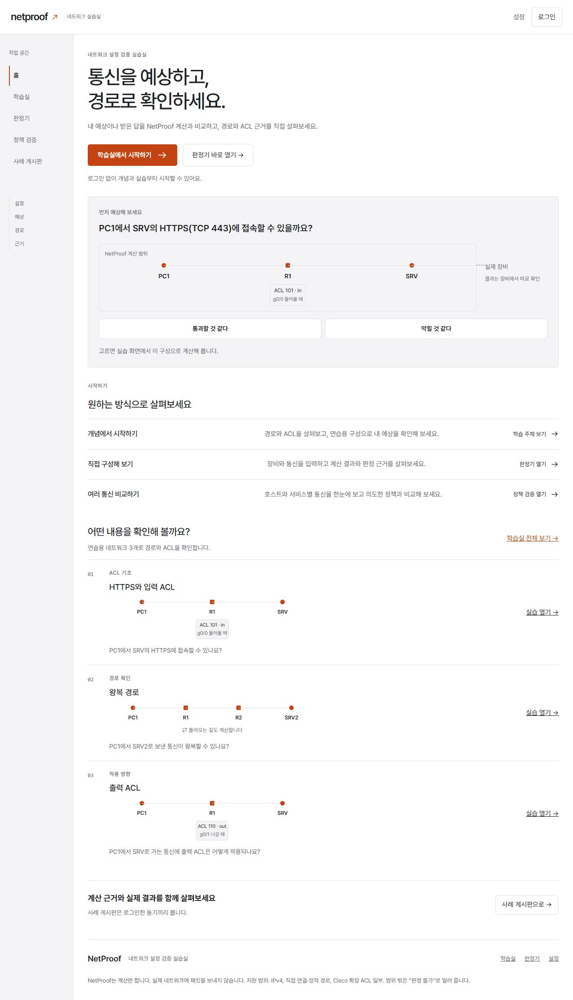

# 경로 작업대

2026-10-11 사용자가 PR #59 병합 뒤 동기 사이트와 비슷한 분위기를 우려해 독자적인 화면 구상을 요청했다. Codex가 홈·실습의 두 시안을 제시했고, 사용자는 ‘경로 작업대’를 선택했다. 청록 바탕을 중성 회색·오렌지 포인트로 수정한 뒤 “좋네 이걸로 하자”로 구현을 승인했다. 기준은 PR #59가 병합된 main `d147af4`다.

## 화면 기준

- 바탕과 본문은 중성 회색, 작은 모서리와 얇은 구분선으로 정리한다. 라이트는 흰 바탕·짙은 글자, 다크는 차콜 바탕·밝은 글자다. 오렌지는 주요 행동·현재 위치·선택한 경로에 쓴다. PASS/DENY·점검·확인의 기존 의미 색은 유지한다.
- 1101px부터 왼쪽 작업 공간에 홈·학습실·판정기·정책 검증·사례 링크를 둔다. 검토자에게만 기존 대시보드 링크를 보인다. 그보다 좁으면 기존 상단 탐색, 960px 이하는 기존 접이식 메뉴를 쓴다. 설정·계정은 헤더에 둔다. 두 탐색 영역이 동시에 보이지 않는다.
- 홈은 소개 다음에 기존 질문·구성도·예상 퍼즐을 전체 폭으로 둔다. 입력 요약·실습 이어서 하기와 다음 퍼즐도 유지한다. 시작 링크는 짧은 행, 학습 주제는 번호·질문·축소 구성도·실습 링크를 가진 목록으로 바꾼다. 카드별 장식 색과 큰 아이콘은 제거한다.
- 학습실의 주제·고치기·수업 도구도 번호와 구분선이 있는 목록으로 정리한다. 기존 제목·설명·과제 문구·링크·출처는 유지한다. 실습·판정·정책·사례·계정은 같은 공통 색·입력·표 체계를 쓴다.
- 승인한 시안은 배치와 분위기의 기준이다. 시안의 가짜 설정 발췌와 미리 만든 판정은 제품에 넣지 않는다. 제품 구성도·결과·재생은 기존 입력과 실제 엔진 응답을 그대로 표시한다. 그림의 선은 주소 구간의 소속이며 실제 배선이 아니다.

## 구현 경계

`web/src` 표시·CSS·회귀 테스트, 이 문서·캡처, HANDOFF·작업 기록만 바꾼다. API 호출·계산·입력 메모리·revision/current()·재생 규칙·검색·저장·인증·집계는 그대로다. 엔진·서버·기준 사례·expect·배포·의존성을 변경하지 않는다. 엔진 버전은 0.2.0이다. 고치기 해법·점수·축하를 추가하지 않으며 시안용 색 선택기를 제품 기능으로 넣지 않는다.

## 실제 제품 화면

127.0.0.1·임시 SQLite에서 빌드한 제품 화면이다. 계정·사례·실측 기록은 QA 합성 데이터이며 실제 장비 관측이 아니다.

## 검증

직접 실행: 엔진489 passed·2 xfailed(7.37s), 서버227 passed·1 skipped(54.40s), 웹44파일656 passed(1.47s), TypeScript 검사·Vite 빌드291ms. 기존 xfail2와 선택 pybatfish skip1을 유지했다. 새 탐색의 기존 주소·현재 위치·검토자 전용 링크와 추가 조회 없음에 대한 회귀11건을 추가했다.

공개10경로·합성 회원4경로 × 320·375·1280px × 라이트/다크 = 84조합, 초기 홈320·375·768·1100·1101·1280px × 라이트/다크 = 12조합을 실제 브라우저에서 확인했다. 페이지 가로 넘침0·보이는 버튼 글자 넘침0·화면 h1=1, 홈 장비 칸 최소60px·ACL 높이 최대100px를 확인했다. 1100px은 상단 탐색, 1101px은 폭164px의 왼쪽 탐색이다. [측정·기능 결과 원문](screens/workbench-qa.json), [실행 출력](../HANDOFF.md#테스트-결과--경로-작업대).

메뉴 Escape·포커스 복원, Tab으로 본문 바로가기·왼쪽 다음 항목 이동, 본문 진입 시 hash 유지, 홈 예상→실습01·해당 예상 유지, 실습02 복귀2/2→1/2→2/2, 정책10건 PASS10, 고치기01 초기 목표 모두 다름·목표 밖 변화0·사실 문장 없음도 확인했다. 브라우저 콘솔 error/warn은 빈 목록이었다. 운영 DB를 사용하지 않았고 QA 종료·포트0 확인 뒤 임시 SQLite·폴더를 삭제했다.

사용자 요청으로 PR #60 제품 커밋 `7d32af0`을 리뷰했다. 엔진489+2xfail(7.48s)·서버227+1skip(57.32s)·웹656(1.65s)·빌드289ms, 금지 경로0줄로 구현 기록과 테스트 수·자산 해시가 같다. 새 임시 SQLite로 공개/회원84조합과 홈·헤더·학습실·복귀 결과 경계 폭61개를 추가 확인해 가로/버튼 넘침과 콘솔 오류0, 메뉴·키보드·예상 진입·복귀 재생·정책·고치기 표시를 확인했다. 수정 지적0건이며 제품 코드는 고치지 않았다. [리뷰 실행 출력](../HANDOFF.md#테스트-결과--pr-60-리뷰), [리뷰 측정 원문](screens/workbench-review-qa.json), [1101px 탐색·포커스](screens/workbench-review-home-1101-light.png), [375px 다크 학습실](screens/workbench-review-learning-mobile-dark.png).

이 검사는 모든 입력 상태·실제 장비 결과·사람의 수동 QA를 대체하지 않는다. 구현과 같은 모델로 수행했으며 별도 Claude/Luna 독립 리뷰 수행 기록은 없다.

## 병합·공개 배포

사용자 “리뷰를 봤을 때 구현할 필요 없으면 병합해” 승인으로 PR #60을 2026-10-11 main `cc9d8a5`에 병합했다. Vercel main 배포 SUCCESS 뒤 공개 홈의 새 제목·왼쪽 탐색164px과 JS `index-C8X6sD2c.js`·CSS `index-D9mPdoNq.css`가 리뷰한 제품과 같음을 확인했다. 공개 학습실 번호 목록9개·가로 넘침0·콘솔 error/warn0도 확인했다. [병합·배포 확인 기록](https://github.com/myeongjundev/netproof/pull/60#issuecomment-6105443031). 운영 DB 작업은 수행하지 않았다.

README는 위 제품 캡처를 재사용하며, 이전 회고 문서는 작성 기준일의 기록으로 유지한다. 다음 작업인 F2·F3는 [용어·답 입력/표시 설계](terminology-claim-design.md)에서 정의한다. 이 설계는 아직 제품에 구현하지 않았다.

Codex (GPT-6)
