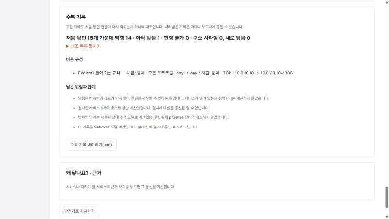

# NetProof v1.0 설계 — 최종 제출본 (방어전에서 배운 것 옮기기)

> 상태: **승인(2026-10-24 사용자 "설계 승인. 수복 기록(A)과 v1.0 릴리스 묶음(B)을 구현하고, 병합 뒤 v1.0.0 태그도 올려 줘")·구현.**
> 작성: 2026-10-24, Claude. 근거: `skt-aleph-defense-lab`(ALEPH BYTE BACK·Keshev 방어전 기록, 3~6차 안내, ZTNA·XDR 패키지 P1~P8)과 NetProof 현재 main(`dd58580`).

## 1. 왜 — 방어전에서 반복해서 배운 것

사용자는 방어전에서 1~22단계, XDR 6과제를 통과했고, 마지막 차수들은 제품을 **v0.5 → v0.9 → v1.0**으로 키우는 구조였다. 기록에서 반복되는 교훈은 다음과 같다.

| 방어전에서 | 근거(방어전 저장소) | NetProof에 옮기면 |
| --- | --- | --- |
| **6차 수복:** "다 막았다"가 아니라 "뚫린 곳을 찾고, 고치고, **같은 공격이 다시 막히는 것을 증명**"으로 판정 | `3~6차 방어전 안내.md` §4 | 침해 가정에서 구성을 고친 뒤, 처음 닿던 연결이 지금 막혔는지 하나씩 대조한 **수복 기록**을 남긴다 |
| **판정·집행·효과를 다른 근거로:** 공식 판정, 로컬 합성 시험, 예제 화면, 운영 효과를 섞지 않는다. 불명을 정상으로 바꾸지 않고, 성공 표시는 검증 뒤 마지막에 | 13~22단계 보고서의 "재사용할 설계" | 수복 기록에 "이것은 모델 계산이며 실제 장비·운영 결과가 아님", 판정 불가·검사 안 한 통신을 따로 적는다(이미 NetProof 원칙과 같다) |
| **21·22단계 설명서·재현·인수인계:** 다른 사람이 안내만 보고 같은 결과를 내야 한다. 같은 최종 소스를 새 폴더에서 재현한다 | `017-keshev-stages-19-22/04-report.md` | 수복 기록을 **Markdown으로 내려받아** 과제·보고서에 붙인다. 제품도 **v1.0 릴리스**로 묶는다(변경 기록·재현 절차·근거 구분) |
| **5차 배포본 묶기·P7·P8:** README대로 배포해 첫 화면까지 가고, 문서가 실제 코드와 맞는다 | `package/SELF-CHECK.md` P7·P8 | README의 오래된 기준(10/11)을 지금 상태로 고치고, v1.0 태그·변경 기록을 단다 |

ZTNA(장면 4)와 XDR(학습실 설명)은 PR #77에서 이미 옮겼다.

## 2. 범위

| | 항목 | 크기 | 결정 |
| --- | --- | --- | --- |
| A | 침해 가정 **수복 기록**(화면 + Markdown 내려받기) | 중 | 이번에 한다 |
| B | **v1.0 릴리스 묶음**(CHANGELOG, 버전 1.0.0, README 갱신, 릴리스 노트, 태그) | 소 | 이번에 한다 |
| C | 변경 요구 단계(5차처럼 고친 뒤 새 요구 하나를 반영) | 중 | 하지 않음 — 후속 후보 |
| D | 규칙 판 번호·변경 이력(D1 정책처럼) | 중~대 | 하지 않음 — 후속 후보 |

## 3. A. 수복 기록

### 3.1 어디에, 언제

- 침해 가정 화면의 "지켜야 할 서비스와 바뀐 통신" 아래, 근거 패널 위에 **"수복 기록"** 구역을 둔다.
- 확인하기를 한 번 이상 했고, 처음 구성 결과(`startMatrix`)와 지금 결과(`matrix`)가 모두 있을 때만 내용을 보인다.
  - 확인 전: "확인하기를 누르면 처음 구성과 지금 구성을 비교한 기록을 만듭니다."
  - 입력이 바뀜(stale): 기존 규칙대로 "이전 결과 · 다시 확인해 주세요"를 보이고 **내려받기를 막는다**(오래된 기록이 새 구성의 기록처럼 나가지 않게).
  - 계산 실패·INVALID: 기록을 만들지 않고 이유를 보인다.

### 3.2 내용 (모두 이미 받은 엔진 응답에서 고르고 세기만 — ADR-001)

1. **가정한 사건:** 장면 제목, 뚫렸다고 가정한 장비와 역할, 계산 시각, 엔진 버전(응답의 `engine_version`).
2. **피해 범위 전/후:** 처음 n곳 · 서비스 m개 → 지금 n'곳 · m'개(이미 화면에 있는 숫자와 같다).
3. **다시 막히는지 대조(6차 회귀에 해당):** 처음 구성에서 뚫린 장비가 닿던 (목적지, 서비스)마다 지금 결과를 적는다.
   - "막힘" — 지금 `PASS`가 아님(DENY).
   - "아직 닿음" — 지금도 `PASS`.
   - "판정 불가" — 지금 `UNSUPPORTED`·`INVALID`. 막혔다고 세지 않는다.
   - 처음엔 안 닿다가 지금 새로 닿는 곳은 "새로 닿음"으로 따로 적는다(고치다가 연 길).
   - 묶음 숫자: "처음 닿던 m개 가운데 막힘 a · 아직 닿음 b · 판정 불가 c, 새로 닿음 d".
4. **지켜야 할 서비스:** 각각 "그대로 됩니다 / 막혔습니다 / 판정 불가"(기존 `keepText`).
5. **바꾼 구성:** 처음 구성과 지금 구성의 차이를 **입력 그대로** 적는다. 엔진을 다시 부르지 않는다.
   - 방화벽 인터페이스별 들어오는 규칙: 처음 목록과 지금 목록을 한 줄 표기(`firewallRuleText`)로 나란히. 같으면 쓰지 않는다.
   - 기본 동작이 바뀐 인터페이스.
   - 장비·인터페이스의 추가·삭제와 주소 변경(예: "LOG eth1 10.0.10.20/24 삭제").
   - ACL 글이 바뀐 경우 "ACL x 변경"만 적는다.
6. **남은 위험과 한계(고정 문구 + 숫자):**
   - "닿음은 방화벽과 경로가 막지 않아 연결을 시작할 수 있다는 뜻입니다. 서비스가 열려 있는지·취약한지는 계산하지 않았습니다."
   - "검사한 서비스(5개)와 호스트 쌍만 계산했습니다. 검사하지 않은 통신은 알 수 없습니다."
   - 방화벽 단계가 있으면 기존 미대조 문장(`FIREWALL_NOTE`).
   - "이 기록은 NetProof 모델 계산입니다. 실제 장비 결과나 운영 효과가 아닙니다."
7. **쓰지 않는 것:** 점수, 정답, "완료", "안전함", 축하. 피해 범위가 0이어도 "막을 곳을 다 막았다"고 쓰지 않는다(검사 범위 밖은 모름).

### 3.3 내려받기

- 단추 "수복 기록 내려받기(.md)" — 위 내용을 Markdown 글로 만들어 `netproof-<장면 id>-수복기록.md`로 받는다(브라우저 `Blob` + `a[download]`, 서버·DB·새 API 없음).
- Markdown 첫 줄 아래에 "합성 구성 · NetProof 모델 계산(실제 장비 결과 아님)"을 고정으로 넣는다.
- 화면 표시와 Markdown은 같은 함수(`remediationReport(...)`)가 만든 같은 데이터에서 나온다(두 벌 문구가 어긋나지 않게).

구현 메모: 화면의 한계 목록은 "방화벽 미대조 문장은 화면에 한 번만" 규칙(#69)에 따라, 바뀐 통신 구역에 이미 그 문장이 있으면 뺀다. 내려받는 파일에는 늘 넣는다. 목적지 주소가 지금 구성에 없으면 "막힘"이 아니라 "주소 사라짐"으로 센다.

### 3.4 코드 경계

- 새 파일 `web/src/remediation.ts`: 순수 함수만.
  - `remediationReport(scenario, startMatrix, matrix, firstNetwork, nowNetwork) → Report | null` — 2~6의 데이터.
  - `reportMarkdown(report) → string`.
  - 내부에서 기존 `reach`, `keepText`, `serviceName`, `firewallRuleText`, `limitationNote`를 쓴다.
- `BreachPage.tsx`: 구역과 단추만 더한다. 상태는 늘리지 않는다(기존 `matrix`·`startMatrix`·`checkedNetwork`·`stale` 사용).
- 엔진·서버·DB·API 변경 없음.

### 3.5 시험

- `remediation.test.ts`: fixture의 처음/좁힌 응답으로
  - 대조 숫자(장면 1에서 em1을 "WEB → DB SSH" 하나로 줄인 기존 fixture: 처음 15개 가운데 막힘 14 · 아직 닿음 1 · 판정 불가 0, 새로 닿음 0),
  - 판정 불가 칸은 "막힘"에 넣지 않음(칸 하나를 UNSUPPORTED로 바꿔 확인),
  - 새로 닿음(처음 DENY → 지금 PASS로 바꾼 합성 응답),
  - 구성 차이(규칙 변경, 인터페이스 삭제, 같으면 비움),
  - Markdown에 점수·정답·완료·안전 표현이 없고 한계 문장이 있음.
- `BreachPage.test.tsx`: 확인 전 안내, 확인 뒤 구역 표시, 입력이 바뀌면 내려받기 단추 비활성.
- 실브라우저: 장면 1·3에서 고친 뒤 기록과 내려받은 파일 내용 확인, 320·375·1280px.

## 4. B. v1.0 릴리스 묶음

- `CHANGELOG.md`(저장소 첫 변경 기록): 1차 점검(10/11) 이전, 10/11~10/24 기능, v1.0의 세 묶음으로 PR 번호와 한 줄 설명. 지난 과제 표에서 옮긴다.
- `web/package.json` 버전 `0.1.0` → `1.0.0`. 계산 엔진 버전(0.2.0)은 판정이 바뀌지 않으므로 그대로 둔다(semantics §15). 둘이 다른 버전임을 변경 기록에 적는다.
- `README.md` 첫 부분의 "PR #60·10/11 기준" 문장을 v1.0 기준으로 고치고, 공개 주소·로컬 실행·시험 명령·재현 절차를 한곳에 모은다(P7).
- `docs/release-v1.0.md`: 무엇이 들어 있나, 어떻게 확인하나(3단계), **근거 구분 표**(자동 시험 수 / 실제 브라우저 확인 / 공개 배포 번들 일치 / 실제 pfSense 장비 미대조 / 다른 사용자 확인 없음 — AI 점검만), 알려진 한계.
- 병합 뒤 main에 태그 `v1.0.0`을 달아 원격에 올린다(태그만, main 강제 푸시 없음).

## 5. 하지 않는 것

- 앱 안 AI(ADR-002), 점수·정답·완료 표시, 엔진·판정 의미 변경, NAT·별칭, 새 서버 API·DB 열, 변경 요구 단계(C)·규칙 이력(D).

## 6. 완료 조건

1. 엔진 508+2xfail·서버 252+1skip 유지, 웹 시험 추가분 포함 통과(종료 0), 빌드 성공, `engine/`·서버 코드 diff 0.
2. 실브라우저: 장면 1·3·4에서 수복 기록이 화면 숫자와 같고, 내려받은 `.md`가 같은 내용이며, 입력을 바꾸면 내려받기가 막힌다.
3. 공개 배포 번들 SHA256 일치, `v1.0.0` 태그가 그 커밋을 가리킨다.
4. HANDOFF·설계 문서·QA 체크리스트 갱신, 작업 기록 한 줄.

## 7. 사용자가 정할 것

- 이 범위(A·B)로 진행할지. C(변경 요구)나 D(규칙 이력)를 넣고 싶으면 일정이 늘어난다.
- 태그 `v1.0.0`을 원격에 올려도 되는지(승인하면 병합 뒤 진행).
