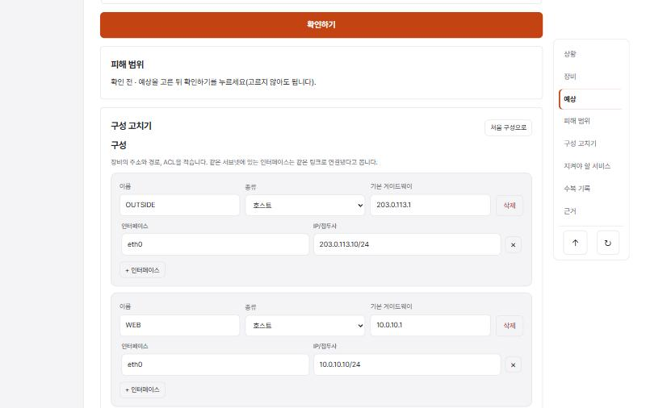
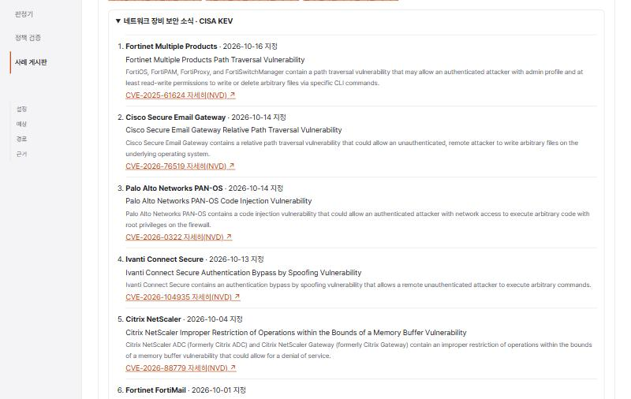

# NetProof v1.1 설계 — pfSense 수업 도구, 구역 이동 막대, 네트워크 장비 보안 소식

> 상태: **승인(2026-10-24 사용자 "설계 승인. 동결을 풀고 A·B·C를 구현해 줘. 업체 목록과 최신 10건은 제안대로, 병합 뒤 v1.1.0 태그도 올려 줘")·구현.** 구현 메모: B의 현재 구역 계산은 IntersectionObserver 대신 스크롤 위치로 했다(같은 결과, 코드가 짧다). 도구 화면의 "NetProof로 해 보기" 제목은 보안 로그 문서를 쓰는 주제(Graylog·Wazuh)만 "NetProof 로그로 해 보기"로 둔다.
> 작성: 2026-10-24, Claude. 근거: 사용자 요청(수업 도구에 pfSense, MSN 날씨식 옆 구역 이동, 사례 게시판에 외부 보안 소식 — 강사님 사이트의 보안 뉴스·KEV 학습관에서 영감).

## A. 수업 도구에 pfSense 추가 (데이터만)

- **왜:** 같은 반 캡스톤 다섯 조가 모두 pfSense를 쓰고, NetProof의 방화벽 입력·침해 가정이 pfSense 방식을 따른다. 그런데 학습실 "수업 도구"에는 Graylog·Wazuh·n8n만 있다.
- **무엇:** `web/src/toolTopics.ts`에 `pfsense` 주제를 기존 세 주제와 같은 모양으로 더한다(새 화면 코드 없음).
  - 제목 "pfSense — 방화벽 규칙으로 구역 나누기", 버전 "pfSense CE 2.7.2"(팀 실습망과 같은 판), 확인일 2026-10-24.
  - 개념: 인터페이스 탭의 규칙은 **들어오는 방향**에 걸린다 / 위에서부터 **첫 일치 하나**를 따른다 / 맞는 규칙이 없으면 **기본 차단** / **상태 추적**이라 허용된 연결의 응답은 규칙 없이 돌아온다 / 별칭(Aliases)·NAT(포트포워딩)·Floating 규칙은 NetProof가 계산하지 않는다(판정 불가).
  - 단계: pfSense `Firewall > Rules`의 인터페이스 탭 규칙을 보고 NetProof 판정기에서 장비 종류 "방화벽"으로 같은 규칙을 적은 뒤 계산 → 실제 `nc`·차단 로그와 비교(관측 ≠ 판정).
  - 확인할 것: 기본 차단으로 막힌 통신은 근거에 "어느 규칙에도 맞지 않아 기본 차단"이 나오는가, 같은 서브넷 통신은 방화벽 단계가 없는가.
  - 출처(접속 확인함): Netgate 문서 Firewall Fundamentals, Rule Methodology, Configuring Firewall Rules, Aliases.
  - "NetProof는 이 도구를 설치하거나 대신 실행하지 않습니다" 안내는 기존 공통 문구 그대로.

## B. 구역 이동 막대 (MSN 날씨의 옆 막대처럼)

- **왜:** 침해 가정 화면이 길다(상황 → 예상 → 피해 범위 → 구성 고치기 → 지켜야 할 서비스 → 수복 기록 → 근거). AI 점검에서도 "근거가 5화면 아래" 문제가 나왔다. 원하는 구역으로 바로 가는 막대가 있으면 길을 잃지 않는다.
- **무엇:** 새 부품 `SectionRail`(훅 하나, 외부 의존성 없음).
  - PC(넓은 화면, 1100px 이상): 본문 오른쪽에 떠 있는 세로 막대. 구역마다 짧은 이름을 두고, **지금 보고 있는 구역을 강조**한다(IntersectionObserver). 아래에 "맨 위로"(↑)와 "다시 확인"(↻ = 확인하기와 같은 동작) 단추.
  - 휴대폰·좁은 화면: 막대를 숨긴다(아래 고정 확인 단추가 이미 있다). 키보드로 순서대로 이동할 수 있고, 링크는 `#` 주소를 바꾸지 않고 구역으로 스크롤한다(해시 라우터와 충돌하지 않게 단추로 만든다).
  - 움직임 줄이기 설정을 따른다(기존 `scrollTo`).
  - 이번에는 **침해 가정 화면에만** 붙인다. 판정기·고치기 과제는 후속 후보.
- **하지 않는 것:** 화면을 덮는 떠 있는 투어(기존 합의 "떠 있는 투어는 만들지 않는다"), 진행률·완료 표시.

## C. 사례 게시판의 "네트워크 장비 보안 소식" (외부 API)

- **왜:** 강사님 사이트의 보안 뉴스·KEV 학습관처럼, 실제로 공격당한 취약점을 보며 "왜 방화벽·접근 통제가 중요한가"를 실습과 잇는다. NetProof 사용자는 네트워크 보안 학생이라 **네트워크·보안 장비**에 좁힌다.
- **데이터:** CISA KEV(Known Exploited Vulnerabilities) 공개 JSON 하나만 쓴다. 키·로그인 필요 없음, 2026-10-24 확인: 1,756건, 그중 네트워크·보안 장비 업체(Cisco·Fortinet·Palo Alto Networks·Juniper·Netgate·SonicWall·Ivanti·Citrix·F5·Check Point·Zyxel·MikroTik·Ubiquiti·TP-Link·D-Link·Sophos 등) 314건.
- **서버가 대신 받는다:** `GET /api/security-news`
  - 정해진 주소 하나만 받는다(사용자가 주소를 넘길 수 없음 — 서버를 다른 곳으로 부르게 하는 공격 차단). 시간 제한 5초, 크기 제한 5MB, JSON 형식 검사.
  - 업체 목록으로 거른 뒤 **지정일(dateAdded) 최신 10건**만 돌려준다: CVE 번호, 업체·제품, 취약점 이름, 지정일, 짧은 설명(영어 원문), 랜섬웨어 악용 여부, NVD·CISA 링크. 카탈로그 판(catalogVersion)과 **서버가 마지막으로 받은 시각**을 함께 준다(방어전 P5 "출처와 마지막 받은 시각").
  - 서버 메모리에 6시간 저장해 다시 받지 않는다. 받기 실패 시 저장해 둔 것이 있으면 그것과 "오래된 자료" 표시를, 없으면 502와 짧은 오류를 준다. 오류에 내부 정보를 넣지 않는다.
  - 사례 게시판과 같게 **로그인한 사람만** 부를 수 있다(401). → **v1.1.1에서 바꿈(2026-10-24 사용자 승인):** 채점하는 사람이 가입하지 않아도 보도록 로그인 없이 공개하고 학습실의 침해 가정 구역에도 보인다. 공개 자료이고 6시간 저장이라 위험이 작으며, 받는 동안 잠가 동시에 여러 번 받으러 가지 않는다. 브라우저 보안 정책(CSP)의 `connect-src 'self'`는 그대로 둔다 — 브라우저는 우리 서버만 부른다.
- **화면:** 사례 게시판 위쪽에 접을 수 있는 구역 "네트워크 장비 보안 소식 · CISA KEV".
  - 항목마다: 지정일 · 업체 제품 · 취약점 이름 · (랜섬웨어 악용 알려짐) · "자세히(NVD)" 새 창 링크(`rel="noopener noreferrer"`). 설명은 영어 원문이라고 적는다(번역·요약하지 않음, 앱 안 AI 없음).
  - 아래 고정 문장: "실제로 공격에 쓰였다고 CISA가 확인한 취약점입니다. 장비를 쓰고 있다면 패치·접근 통제가 우선입니다. NetProof는 이 취약점을 계산하지 않습니다. 출처: CISA KEV · 카탈로그 판 … · 받은 시각 …".
  - 불러오는 중/실패/오래된 자료를 구분해 보인다. 실패해도 사례 목록은 그대로 동작한다.
- **하지 않는 것:** 다른 뉴스 사이트 긁어오기(저작권·약관), 사용자가 고른 주소 받기, 앱 안 AI 요약, DB 저장, 알림.

## 버전·문서

- 병합 뒤 웹 1.1.0, `CHANGELOG.md`에 v1.1.0, 태그 `v1.1.0`(승인 시). 계산 엔진 0.2.0 그대로(판정 변경 없음).
- 서버에 새 API가 생기므로 `docs/deploy.md`·README에 바깥으로 나가는 요청(CISA 한 곳)과 실패 시 동작을 적는다.

## 시험

- A: 기존 `toolTopics` 형식 시험이 새 주제에도 돈다(출처 주소·확인일·안내 문구). 학습실에 카드 4장.
- B: 구역 목록·강조 계산은 순수 함수로 시험, 화면은 정적 렌더(구역 단추·맨 위로·다시 확인). 실브라우저에서 1280px 표시·375px 숨김·키보드 이동.
- C: 서버 시험(외부 요청은 가짜로 바꿈): 거르기·정렬·10건 제한, 6시간 저장, 시간 초과·형식 오류·크기 초과 시 502·오래된 자료, 비로그인 401, 응답에 내부 정보 없음. 웹 시험: 목록·실패·오래된 자료·링크 속성. 실브라우저에서 실제 CISA 자료 한 번 확인.

## 사용자가 정할 것

1. 이 세 기능으로 동결을 풀지.
2. C의 업체 목록(위 16곳)과 "최신 10건"이 적당한지.
3. 병합 뒤 `v1.1.0` 태그를 올릴지.

## 화면

